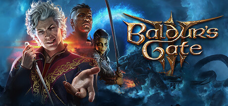

**Baldur's Gate II: Shadows of Amn is the legendary D&D RPG following your character's escape from the wizard Irenicus's dungeon and their quest across the powerful city of Athkatla. Features the deepest party building in CRPG history and hundreds of hours of content.**

---

## 📖 About

Baldur's Gate II: Shadows of Amn is the legendary D&D RPG following your character's escape from the wizard Irenicus's dungeon and their quest across the powerful city of Athkatla. Features the deepest party building in CRPG history and hundreds of hours of content.

## ⚠️ Problems Without Trainer

| Problem | Status |
|---------|--------|
| **Difficulty for Newcomers** — Even on Normal, enemies use advanced D&D tactics that punish unprepared parties | ✅ Solved |
| **D&D Rules Depth** — THAC0, saving throws, and spell memorization require significant system knowledge | ✅ Solved |
| **Spellbook Management** — Memorizing and deploying the right spells for each encounter is essential | ✅ Solved |
| **Irenicus Dungeon Opening** — First dungeon is deliberately difficult and discourages new players | ✅ Solved |

## ✅ Solution

The **Baldur's Gate II Trainer** solves all these issues by giving you complete control over the game.

## 🎯 Full Feature List

- Unlimited Resources
- God Mode / Invincibility
- Instant Skill Cooldown
- One-Hit Kill
- Freeze Game Timer
- Unlock All Items & Achievements
- Custom Speed Multiplier
- Save State Anywhere

## 🚀 Quick Start

1. **Disable Windows Defender** temporarily (trainer may trigger false positive)
2. Download the trainer from the button above
3. Launch Baldur's Gate II
4. Run the trainer as Administrator
5. Activate desired cheats with hotkeys

## 💎 Free vs Paid

| Feature | Free | Pro |
|---------|------|-----|
| Basic God Mode | ✅ | ✅ |
| Unlimited Resources | ✅ | ✅ |
| All Advanced Cheats | ❌ | ✅ |
| Auto-Updates | ❌ | ✅ |
| Priority Support | ❌ | ✅ |

## 💻 Requirements

- Windows 10/11 (64-bit)
- Baldur's Gate II (any version)
- .NET Framework 4.8+
- DirectX 11+

## 🍎 macOS

macOS users can use our alternative tool:

## ⚖️ Legal

This trainer is for educational and single-player use only. Use responsibly.

---

